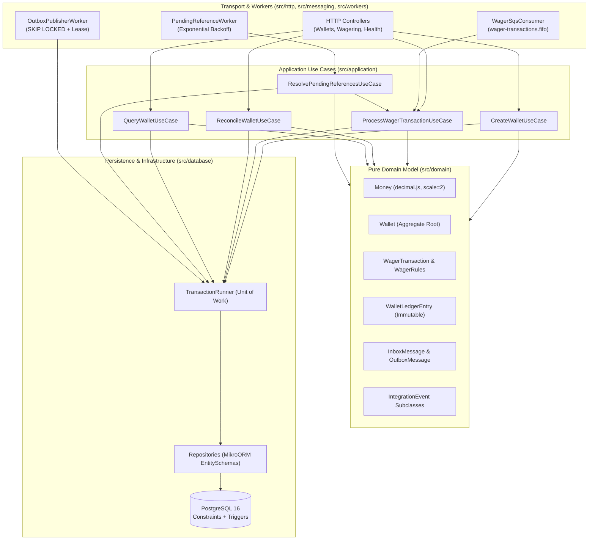

# Architecture & Technical Decisions (`ARCHITECTURE.md`)

## 1. Architectural Overview

This service implements a **Distributed Wagering Processor** designed around financial correctness, multi-instance concurrency safety, persistent idempotency, and at-least-once messaging resilience.

Rather than adding unnecessary layers of indirection, the codebase follows a **pragmatic DDD + Clean Modular architecture** split into four explicit boundaries:

### Key Structural Principles
- **Zero framework leakage in the domain (`src/domain/`):** Domain classes depend only on `decimal.js` and Node's built-in `crypto`. They have `private` constructors and static factories (`create`, `from`, `open`, `rehydrate`).
- **Single shared use case for HTTP and SQS:** Both `WageringController` (`POST /wagering/transactions`) and `WagerSqsConsumer` (`wager-transactions.fifo`) invoke `ProcessWagerTransactionUseCase`.
- **Single atomic SQL transaction per operation:** Inbox registration (when triggered via SQS), wallet balance update, transaction state persistence, immutable ledger entry insertion, and outbox event enqueueing all execute inside one PostgreSQL transaction managed by `TransactionRunner`.

---

## 2. ORM Choice, Money Mapping & Transactional Strategy

### Why MikroORM?
We selected **MikroORM v6 (`@mikro-orm/postgresql`)** over TypeORM for three reasons:
1. **Explicit Unit of Work & `EntityManager.transactional()`:** Every operation forks an isolated `EntityManager` (`orm.em.fork()`) and runs inside `em.transactional()`, preventing accidental shared state across concurrent requests.
2. **First-class Pessimistic Locking (`LockMode`):** Native support for `LockMode.PESSIMISTIC_WRITE` (`SELECT ... FOR UPDATE`) and `LockMode.PESSIMISTIC_PARTIAL_WRITE` (`SELECT ... FOR UPDATE SKIP LOCKED`).
3. **Clean separation via `EntitySchema`:** Persistence rows (`WalletRow`, `WagerTransactionRow`, `LedgerEntryRow`, `InboxMessageRow`, `OutboxMessageRow` in `src/database/entities.ts`) are mapped via `EntitySchema` without polluting domain classes with ORM decorators.

### How `Money` is Mapped and Protected
- **In memory:** `Money` wraps `Decimal` (`decimal.js`) with a fixed scale of **2 decimal places** (`ROUND_HALF_EVEN`) and an ISO-4217 3-letter uppercase currency code.
- **At contract boundaries:** `Money.from(props)` only accepts strings matching `/^(0|[1-9]\d{0,17})\.\d{2}$/`. Any `number`, `NaN`, `Infinity`, scientific notation (`1e5`), negative string, or wrong scale is rejected immediately with `InvalidMoneyError` (`400 Bad Request`).
- **In PostgreSQL:** Stored as `numeric(20,2)` + `char(3)`. The `pg` driver returns `numeric` columns as strings, which repositories pass to `Money.fromPersistence(amount, currency)`—never converting through JavaScript `number`.

---

## 3. Concurrency Control & Lock Ordering

The **unit of concurrency is `walletId`**. Different wallets are processed completely in parallel without global locks.

### Hybrid Pessimistic + Optimistic Protection
1. **Row-level pessimistic lock (`SELECT ... FOR UPDATE`):**
   - Before evaluating any wager or mutating a wallet, `ProcessWagerTransactionUseCase` acquires an exclusive row lock on `wallets` via `ctx.wallets.lockById(walletId)` (`LockMode.PESSIMISTIC_WRITE`).
   - Every transaction sets `SET LOCAL lock_timeout = '2000ms'` (configurable via `LOCK_TIMEOUT_MS`). If a hot wallet is under extreme contention and the lock cannot be acquired within the timeout, PostgreSQL aborts with SQLSTATE `55P03`, which `translateDatabaseError()` maps to `TransientError` (`503 Service Unavailable` on HTTP, retry with backoff on SQS) and increments `wallet_lock_conflicts_total`.
2. **Version-checked update (`WHERE id = ? AND version = ?`):**
   - `WalletRepository.update()` includes the expected `version` in the `WHERE` clause and increments `version` only when the balance changes.
3. **Database-level version uniqueness (`UNIQUE (wallet_id, wallet_version)`):**
   - `wallet_ledger_entries` enforces `UNIQUE (wallet_id, wallet_version)`, guaranteeing that two concurrent writers can never record the same wallet version.
4. **Deadlock-free global lock ordering:**
   - Every code path that locks both a wallet and a transaction (including `ResolvePendingReferencesUseCase`) **always locks `wallets` first and `wager_transactions` second**. Consistent lock ordering makes deadlocks between normal wagers and background workers impossible.

---

## 4. Database Schema Guarantees & Triggers

All invariants required by Sections 5 and 6 are enforced directly in PostgreSQL (`src/database/migrations/Migration20261112000000Initial.ts`):

| Invariant | PostgreSQL Enforcement |
|---|---|
| One wallet per `playerId + currency` | `CONSTRAINT wallets_player_currency_uq UNIQUE (player_id, currency)` |
| Wallet balance never negative | `CONSTRAINT wallets_balance_non_negative_ck CHECK (balance >= 0)` |
| Persistent idempotency (per provider) | `UNIQUE (provider_id, idempotency_key)` and `UNIQUE (provider_id, external_transaction_id)` |
| Single reversal per reference | Partial unique index `wager_tx_single_reversal_uq ON wager_transactions (reference_transaction_id) WHERE kind IN ('REFUND','ROLLBACK') AND status = 'PROCESSED'` |
| Terminal transactions are frozen | `BEFORE UPDATE OR DELETE` trigger `wager_tx_guard_trg` rejects deletes and blocks mutations once `status IN ('PROCESSED','REJECTED','FAILED')` |
| Ledger is strictly append-only | `BEFORE UPDATE OR DELETE` and `BEFORE TRUNCATE` triggers (`ledger_append_only`) reject any mutation or deletion |
| Ledger entry arithmetic | `CHECK ((direction = 'CREDIT' AND balance_after = balance_before + amount) OR (direction = 'DEBIT' AND balance_after = balance_before - amount))` |
| At most one ledger entry per tx | `CONSTRAINT ledger_wallet_transaction_uq UNIQUE (wallet_id, transaction_id)` |
| `wallet.balance == latest ledger entry` | `DEFERRABLE INITIALLY DEFERRED` constraint triggers (`wallets_ledger_consistency_trg`, `ledger_wallet_consistency_trg`) verify at `COMMIT` time that `(wallets.balance, wallets.version)` equals `(balance_after, wallet_version)` of the latest ledger entry for that wallet |

---

## 5. Persistent Idempotency & Canonical Payload Hash

1. **Source of truth:** On HTTP, the `Idempotency-Key` header is mandatory. On SQS, `data.idempotencyKey` (defaulting to `"{providerId}:{externalTransactionId}"`) is used.
2. **Provider scoping:** Keys are scoped by `(providerId, idempotencyKey)` and `(providerId, externalTransactionId)` so one provider can never collide with or probe another provider's keys.
3. **Canonical `payloadHash` (`src/domain/wagering/payload-hash.ts`):**
   - Computes `SHA-256` (hex) over a canonical JSON string (keys sorted recursively, `undefined` keys omitted) of the business fields: `providerId`, `externalTransactionId`, `playerId`, `walletId`, `roundId`, `gameId`, `kind`, `money: { amount, currency }`, and `referenceExternalTransactionId`.
   - Transport metadata (HTTP headers, SQS `messageId`, timestamps) is excluded, so an operation sent over HTTP and re-sent over SQS produces the exact same hash.
4. **Replay vs. Conflict:**
   - **Same key + same `externalTransactionId` + same `payloadHash`:** Returns the original outcome (`transactionId`, `status`, `failureCode`, and the exact `balanceAfter` observed at the moment the transaction was processed) with `idempotentReplay: true` (`200 OK` for `PROCESSED`).
   - **Same key (or same `externalTransactionId`) + different `payloadHash`:** Throws `ConflictError("IDEMPOTENCY_CONFLICT")`, mapped to `409 Conflict`.

---

## 6. Business Rules & Out-of-Order References (`PENDING_REFERENCE`)

### Reversal Rules (`REFUND` and `ROLLBACK`)
- Both require `referenceExternalTransactionId`, resolved by `(providerId, referenceExternalTransactionId)`.
- The referenced transaction must belong to the **same `providerId`, `playerId`, `walletId`, `currency`, and `roundId`**, and its amount must equal the reversal amount.
- `REFUND` can only target a `BET`. `ROLLBACK` can target a `BET`, `WIN`, or `REFUND`.
- A `PROCESSED` reference can be reversed **at most once** across `REFUND`/`ROLLBACK` (enforced both in `WagerRules` and by the partial unique index `wager_tx_single_reversal_uq`).
- If a `ROLLBACK` of a `WIN` or `REFUND` would drive the wallet balance below zero, it is rejected with `FailureCode.ReversalInsufficientFunds` (`REVERSAL_INSUFFICIENT_FUNDS`), kept distinct from `FailureCode.InsufficientFunds` (`INSUFFICIENT_FUNDS`) for a regular `BET`.

### Out-of-Order Handling (`PendingReferenceWorker`)
- When a transaction references an operation that has not arrived yet (or is still `PENDING_REFERENCE` itself), it is persisted as `PENDING_REFERENCE`, emits `WagerTransactionPendingReference`, and schedules `nextReferenceAttemptAt = now + baseDelayMs * 2^attempts` (HTTP returns `202 Accepted`).
- `PendingReferenceWorker` polls due rows (`status = 'PENDING_REFERENCE' AND next_reference_attempt_at <= now()`), locks the wallet first, claims the transaction with `FOR UPDATE SKIP LOCKED`, and re-evaluates `WagerRules.decide()`.
- After `PENDING_REF_MAX_ATTEMPTS` (default `8`, exponential backoff starting at `2000ms`), if the reference is still missing, the transaction transitions to `REJECTED` with `FailureCode.ReferenceNotFound` and emits `WagerTransactionRejected`.

---

## 7. SQS Consumer, Persistent Inbox & Transactional Outbox

### SQS Consumer (`WagerSqsConsumer`)
- Consumes `wager-transactions.fifo` with dead-letter redrive to `wager-transactions-dlq.fifo`.
- **Persistent Inbox:** Inserts `(consumer_name, message_id)` into `inbox_messages` via `INSERT ... ON CONFLICT DO NOTHING RETURNING message_id` inside the same SQL transaction as the financial effects.
- **Ack after commit:** `DeleteMessage` is called **only after** `TransactionRunner.run()` commits. If the process crashes after commit and before `DeleteMessage`, redelivery hits the inbox entry and is safely acked without duplicating any debit or credit.
- **Error classification:**
  - *Business outcomes* (`PROCESSED`, `REJECTED`, `PENDING_REFERENCE`, replay): committed and **acked**.
  - *Transient errors* (`TransientError`, DB lock timeout, temporary outage): visibility timeout updated with exponential backoff (`2^(receiveCount-1)` seconds) up to `SQS_MAX_RECEIVE_COUNT`; once exhausted, moved to `wager-transactions-dlq.fifo`.
  - *Permanent errors* (invalid JSON, schema failure, `WALLET_NOT_FOUND`, `IDEMPOTENCY_CONFLICT`): moved immediately to `wager-transactions-dlq.fifo` with a `DlqReason` attribute so they never block the FIFO message group.
- **Graceful shutdown (`SIGTERM`):** Stops polling, waits for in-flight handlers to finish, and releases visibility timeout (`0s`) for any prefetched messages.

### Transactional Outbox (`OutboxPublisherWorker`)
- Every domain transition writes its `IntegrationEvent` envelope (`WagerTransactionProcessed`, `WagerTransactionRejected`, `WagerTransactionPendingReference`, `WalletBalanceChanged`) into `outbox_messages` in the **same SQL transaction**.
- Publishers claim batches using `FOR UPDATE SKIP LOCKED` and set a time-bounded lease (`locked_by = instanceId`, `locked_until = now() + leaseMs`).
- Events are published to `wallet-events.fifo` with `MessageGroupId = aggregateId` and `MessageDeduplicationId = eventId`.
- If a publisher crashes after claiming a batch, its lease expires after `OUTBOX_LEASE_MS` and another instance takes over. If it crashes after sending to SQS but before `markPublished`, the next publisher re-sends with the same `eventId` so downstream consumers (and SQS FIFO deduplication) stay idempotent.

---

## 8. Authentication Decision & Extension Point (Section 2)

As permitted by Section 2 of the challenge, we opted **not** to run an external IdP container so that 100% of the engineering focus stays on financial correctness, concurrency, idempotency, and messaging resilience.

- **Extension point in code (`src/http/provider-auth.guard.ts`):**
  - `ProviderIdentityPort` defines the contract `verifyRequest(headers) -> Promise<AuthenticatedPrincipal | null>`.
  - `ProviderAuthGuard` is registered globally as `APP_GUARD`. Health and metrics routes (`/health/live`, `/health/ready`, `/metrics`) are marked with `@Public()` and bypass authentication.
  - `NoopProviderIdentityAdapter` is wired by default for local evaluation.
- **Production Design with Keycloak / Zitadel:**
  1. Each game provider is provisioned as a confidential OAuth2 client (`client_credentials` grant) in **Keycloak** or **Zitadel**, receiving a client token containing custom claims `provider_id` and scopes (`wagering:write`, `wagering:read`, `wallets:write`, `wallets:read`).
  2. A `JwksProviderIdentityAdapter` implements `ProviderIdentityPort`, validating the `Authorization: Bearer <JWT>` signature against the IdP's cached JWKS endpoint (`/.well-known/jwks.json`), checking `iss`, `aud`, `exp`, and required scopes.
  3. On `POST /wagering/transactions`, the guard asserts `principal.providerId === body.providerId`, preventing one authenticated provider from submitting transactions on behalf of another.

---

## 9. Failure Code & HTTP Status Taxonomy

| Situation | HTTP Status | Error / Failure Code | Provider Action |
|---|---|---|---|
| New transaction applied (`PROCESSED`) | `201 Created` | — | Success |
| Idempotent replay of `PROCESSED` | `200 OK` | `idempotentReplay: true` | Success (already applied) |
| Reference not arrived yet (`PENDING_REFERENCE`) | `202 Accepted` | — | Poll or await integration event |
| Malformed JSON, invalid UUID, invalid `Money`, missing `Idempotency-Key` | `400 Bad Request` | `VALIDATION_ERROR` / `INVALID_MONEY` | Fix payload; do not retry unchanged |
| Wallet or transaction not found | `404 Not Found` | `WALLET_NOT_FOUND` / `TRANSACTION_NOT_FOUND` | Check identifier |
| Duplicate wallet or reused `Idempotency-Key` with different payload | `409 Conflict` | `WALLET_ALREADY_EXISTS` / `IDEMPOTENCY_CONFLICT` | Generate a new key or inspect original tx |
| Business rejection: bet exceeds balance | `422 Unprocessable Entity` | `INSUFFICIENT_FUNDS` | Terminal business outcome; do not retry |
| Business rejection: reversal exceeds balance | `422 Unprocessable Entity` | `REVERSAL_INSUFFICIENT_FUNDS` | Terminal business outcome; alert ops |
| Business rejection: wrong currency / player | `422 Unprocessable Entity` | `CURRENCY_MISMATCH` / `PLAYER_MISMATCH` | Terminal business outcome |
| Business rejection: invalid reference | `422 Unprocessable Entity` | `REFERENCE_NOT_FOUND` / `REFERENCE_INVALID_KIND` / `REFERENCE_MISMATCH` / `REFERENCE_NOT_PROCESSED` / `REFERENCE_ALREADY_REVERSED` / `AMOUNT_MISMATCH` | Terminal business outcome |
| Lock timeout, deadlock, DB/SQS temporary outage | `503 Service Unavailable` | `TRANSIENT_FAILURE` (`retryable: true`) | Safe to retry with the same `Idempotency-Key` |

---

## 10. Known Trade-offs & Limitations

1. **Fixed 2-decimal scale across currencies:** `Money` enforces 2 decimal places (`NUMERIC(20,2)`), which covers `BRL`, `USD`, `EUR`, and `GBP`, but would require a per-currency scale table for 0-decimal (`JPY`, `CLP`) or 3-decimal (`KWD`, `BHD`) currencies.
2. **Single-row hot wallet throughput ceiling:** Because all balance mutations on a single `walletId` serialize on its PostgreSQL row lock (`SELECT ... FOR UPDATE`), a single hot wallet is bounded by sequential transaction commit latency (~100–200 tx/s locally). Across distinct wallets, throughput scales horizontally across instances.
3. **Single reversal per reference (`REFUND` or `ROLLBACK`):** Our partial unique index blocks reversing the same reference more than once in total (preventing a double credit when both `REFUND` and `ROLLBACK` are sent for the same `BET`). Reversing a mistaken `REFUND` is still supported by sending a `ROLLBACK` referencing the `REFUND`'s own `externalTransactionId`.

