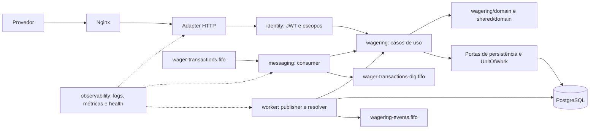
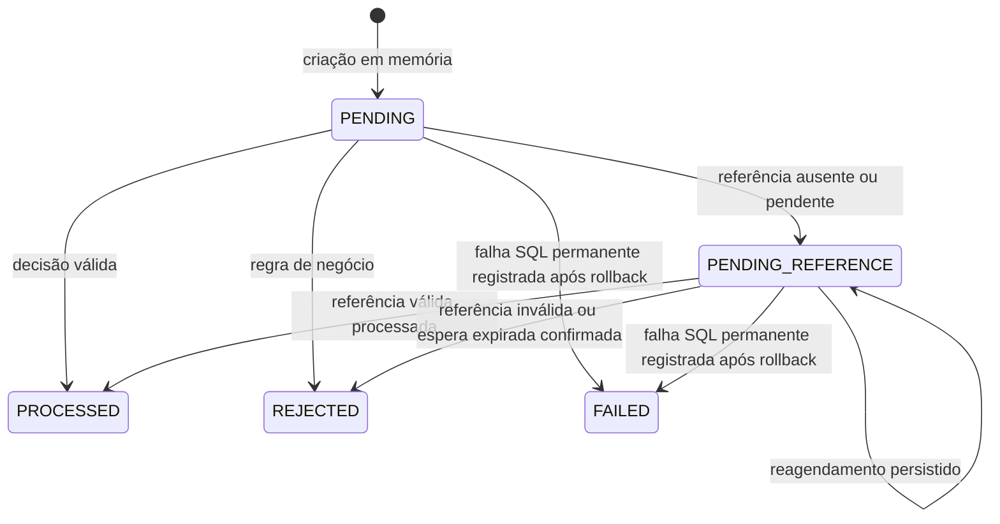

# Arquitetura

O Distributed Wagering Processor mantém a decisão financeira no PostgreSQL. HTTP e SQS reutilizam o mesmo caso de uso; identidade persistente, lock por carteira, transação SQL, ledger imutável e outbox protegem o processamento entre instâncias, retries e crashes. O broker transporta comandos e eventos, mas suas janelas de deduplicação e ordenação não substituem essas garantias.

A [visualização HTML offline](docs/architecture.html) apresenta módulos, transação financeira, recuperação e topologias local/AWS. O [README](README.md) reúne setup e comandos. [Verificação](docs/verification.md) relaciona os cenários e sua evidência; [teste de carga](docs/load-test.md) registra método, versões, resultados e limites das medições. Resultados pertencem às fontes e imagens identificadas nesses documentos, não automaticamente a toda revisão posterior.

## Módulos e execução

O sistema é um monólito modular NestJS, com uma imagem de aplicação e três roles configuradas por `APP_ROLE`. `api` recebe o tráfego HTTP pelo Nginx no Compose local; `consumer` inicia o polling de comandos SQS; `worker` inicia o publisher do outbox e o resolver de referências pendentes. A composição dos módulos é compartilhada, e a role controla o início dos loops. Não há serviço intermediário entre as entradas e o domínio.



O diagrama mostra o ambiente local. A extensão experimental AWS usa um ALB interno na entrada e serviços ECS privados, mantendo as três roles e as garantias SQL descritas aqui; seus pré-requisitos adicionais estão em [infra/aws/README.md](infra/aws/README.md).

| Módulo | Responsabilidade e limite |
| --- | --- |
| `wagering` | Carteira, transação, ledger, liquidação, referências, consultas e reconciliação. Os casos de uso coordenam o domínio e as portas SQL. |
| `messaging` | Inbox/outbox persistentes, transporte SQS, polling e publicação. `MessagingPersistenceModule` fornece persistência sem exigir que o caso de uso inicie os loops de consumo. |
| `identity` | Adapter `jose` para JWT/JWKS e autorização HTTP por escopo/provedor. Não decide regras financeiras. |
| `shared` | `Money`, erros, contrato de evento, transação e infraestrutura comum. Não armazena um saldo ou registro de idempotência alternativo em memória. |
| `observability` | Logs estruturados, métricas, liveness, readiness e amostragem de dependências. |

Entidades e objetos de domínio usam construtores privados, factories e `rehydrate`. A reidratação reconstrói o estado persistido sem executar novamente uma transição de negócio. O domínio não importa NestJS, MikroORM, AWS SDK ou tipos monetários do ORM; os mapeamentos ficam em `infrastructure/records.ts`. As camadas existem onde há código necessário; não foram adicionados CQRS, barramento interno ou facades.

Fontes: [composição](src/app.module.ts), [WageringModule](src/wagering/wagering.module.ts), [persistência de mensagens](src/messaging/messaging-persistence.module.ts) e [runtime de mensagens](src/messaging/messaging-runtime.module.ts).

## Dinheiro e persistência

`Money` é imutável e representa centavos com `bigint`. O contrato externo recebe e serializa `amount` como string decimal de duas casas e `currency` como três letras maiúsculas. Não há conversão de dinheiro para `number`, arredondamento com ponto flutuante ou normalização silenciosa de uma entrada inválida.

O formato aceito é `0.00` ou uma parte inteira sem zeros supérfluos, com até 16 dígitos, seguida de duas casas. Valores negativos, notação científica, vírgula, espaços, casas ausentes/excedentes e números JSON são inválidos. As operações entre moedas diferentes falham. `Money.zero` é válido; valores internos negativos podem representar, por exemplo, uma diferença de reconciliação, sem autorizar saldo persistido negativo.

`BET`, `WIN`, `REFUND` e `ROLLBACK` exigem valor positivo. Um `0.00` bem formado nesses tipos é rejeição de negócio `AMOUNT_NOT_POSITIVE`, e não erro de formato. `LOSS` é informativo: aceita zero e não altera saldo nem cria lançamento. Abertura com saldo positivo cria uma transação interna `OPENING`, um crédito no ledger e os dois eventos correspondentes; abertura zero não cria esse movimento. A wallet começa na versão 1; cada movimento posterior incrementa a versão.

MikroORM foi mantido como adapter PostgreSQL e gerenciador de transações/migrações. Os campos monetários usam `DecimalType("string")` e colunas `numeric(18,2)`: o driver entrega strings, e os mappers reconstroem `Money`. Timestamps usam `timestamptz` e são serializados em UTC. A representação do domínio permanece independente do ORM.

Fontes: [Money](src/shared/domain/money.ts), [records](src/wagering/infrastructure/records.ts), [mappers](src/wagering/infrastructure/mappers.ts) e [abertura](src/wagering/application/open-wallet.ts).

## Transação, lock e invariantes

Cada execução abre um EntityManager isolado e uma transação `READ COMMITTED`. A `UnitOfWork` aplica `SET LOCAL lock_timeout = '2s'` e fornece um contexto opaco aos repositórios durante o callback. O resultado da UOW só se resolve depois da confirmação SQL.

Na submissão, a ordem é claim do inbox quando a entrada é SQS, lock da wallet com `SELECT ... FOR UPDATE`, consulta de chave idempotente e identidade externa, avaliação do domínio e persistência do resultado. Quando há movimento, a mesma transação inclui saldo/versão, transação, ledger, eventos do outbox e conclusão do inbox. Nenhum send SQS pertence à transação financeira.

```mermaid
sequenceDiagram
    participant H as HTTP autenticado
    participant C as Consumer SQS
    participant U as SubmitWagerTransaction
    participant DB as PostgreSQL
    participant Q as SQS
    alt Entrada HTTP
        H->>U: Comando e Idempotency-Key
    else Entrada SQS
        Q->>C: Envelope e receipt handle
        C->>U: Mesmo comando e identidade do inbox
    end
    U->>DB: BEGIN; claim inbox se SQS
    U->>DB: Lock da wallet; buscar chave e external ID
    alt Mesma chave e hash
        DB-->>U: Resultado já armazenado
        Note over U,DB: Sem novo movimento, ledger ou evento
    else Identidade conflitante
        Note over U,DB: Sem nova liquidação financeira
    else Operação nova
        U->>U: Validar referência e liquidar
        U->>DB: Persistir resultado e, se houver movimento, wallet e ledger
        U->>DB: Persistir eventos no outbox
    end
    U->>DB: Concluir inbox se SQS; COMMIT
    DB-->>U: Commit concluído
    alt Entrada HTTP
        U-->>H: Estado e indicador de replay, ou conflito
    else Entrada SQS
        U-->>C: Resultado confirmado
        opt Resultado FAILED
            C->>Q: Confirmar encaminhamento à DLQ
        end
        C->>Q: DeleteMessage após commit
    end
```

A unidade de concorrência é a wallet. A linha bloqueada impede que duas instâncias calculem movimentos a partir do mesmo saldo anterior. Wallets diferentes não compartilham esse lock; ainda disputam recursos finitos, como conexões, CPU, disco e broker. As constraints fecham corridas que uma consulta anterior, especialmente para uma wallet inexistente, não consegue impedir sozinha.

O resolver de referências preserva a ordem de lock financeiro. A seleção automática bloqueia primeiro uma wallet com trabalho devido usando `FOR UPDATE OF w SKIP LOCKED`; dentro dela escolhe uma pendência devida com `FOR UPDATE SKIP LOCKED`, por próxima tentativa e ID. O caminho explícito relê o estado depois de bloquear a wallet. `SKIP LOCKED` permite que outro worker procure trabalho disponível sem esperar o item já reclamado; não promete fairness ou ordem global.

A escolha pessimista reduz o protocolo necessário para uma wallet concorrida: a decisão usa o saldo corrente protegido durante a UOW. Uma abordagem otimista exigiria repetir a liquidação completa após conflito; isolamento serializable acrescentaria aborts/retries ao modelo existente; advisory locks exigiriam outra identidade de lock além da linha. Um lock global violaria a independência entre wallets. FIFO sozinho também não coordenaria HTTP, redelivery e todas as instâncias.

As invariantes combinam aplicação e schema:

- Uma identidade idempotente não gera um segundo efeito financeiro.
- Saldo, transação, ledger, inbox e outbox da decisão são atômicos na UOW.
- Saldo e saldos registrados no ledger não ficam negativos.
- Cada movimento produz no máximo um lançamento por transação/wallet, com versão exclusiva e aritmética exata.
- Ledger é append-only; uma compensação gera outra transação e outro lançamento.
- Eventos só podem ser enviados depois que a transação que os criou confirmou.
- O saldo da wallet deve coincidir com a soma de créditos menos débitos do ledger, incluindo o crédito inicial quando existe.

A reconciliação obtém saldo armazenado e soma do ledger no mesmo statement SQL, retorna a diferença exata em `Money` e sinaliza divergência. Ela não corrige saldo nem altera o ledger. A igualdade agregada é verificada por reconciliação e testes; não existe uma `CHECK` entre todas as linhas das tabelas que a imponha sozinha.

Fontes: [UOW](src/shared/infrastructure/unit-of-work.ts), [submissão](src/wagering/application/submit-wager-transaction.ts), [repositórios](src/wagering/infrastructure/repositories.ts), [writer](src/wagering/application/settlement-writer.ts) e [reconciliação SQL](src/wagering/infrastructure/reconciliation.ts).

## Schema e migrações

A [migração versionada](database/migrations/Migration202610310001.ts) cria cinco tabelas. Os `EntitySchema`s fazem o mapeamento; as garantias abaixo estão declaradas na migração, sem depender de sincronização automática do ORM.

| Tabela | Identidade, relações e garantias de unicidade |
| --- | --- |
| `wallets` | PK `id`; `uq_wallets_player_currency` assegura uma wallet por jogador/moeda; `uq_wallets_id_currency` sustenta a FK composta do ledger. |
| `wager_transactions` | PK `id`; `uq_wager_transactions_provider_key` protege `(provider_id,idempotency_key)`; `uq_wager_transactions_provider_external` protege `(provider_id,external_transaction_id)`; `uq_wager_transactions_id_wallet` sustenta a FK composta do ledger; `fk_wager_reference` aponta para a referência interna resolvida. |
| `wallet_ledger_entries` | PK `id`; `uq_ledger_wallet_transaction` impede dois lançamentos da mesma transação/wallet; `uq_ledger_wallet_version` impede versão repetida; `fk_ledger_wallet_currency` exige wallet/moeda correspondente e `fk_ledger_transaction_wallet` exige transação da mesma wallet. |
| `inbox_messages` | PK `(consumer_name,message_id)` fornece deduplicação persistente por consumidor. Guarda hash e instantes de recebimento/conclusão. |
| `outbox_messages` | PK `id`, igual ao `eventId`; guarda envelope, agregado, tipo, instante, tentativas, próxima execução e confirmação. |

`wager_transactions.wallet_id` deliberadamente não possui FK para `wallets`: uma wallet desconhecida deve poder produzir uma rejeição auditável `WALLET_NOT_FOUND`, com saldo observado nulo e evento de rejeição. O ledger mantém suas FKs e não pode criar um movimento para uma wallet inexistente.

As 25 `CHECK`s declaradas cobrem estes grupos:

| Tabela | Condições verificadas no banco |
| --- | --- |
| `wallets` | Jogador com comprimento permitido, moeda de três letras maiúsculas, saldo não negativo e versão pelo menos 1. |
| `wager_transactions` | Tipo e status admitidos; valor e saldo observado não negativos; moeda válida; tentativas não negativas; `OPENING` se e somente se o provider é `internal`; referência externa obrigatória em `REFUND`/`ROLLBACK` e proibida em `BET`/`OPENING`; `failure_code` presente se e somente se `REJECTED`/`FAILED`; `PROCESSED` exige horário e saldo observado; movimento processado diferente de `LOSS` exige valor positivo; saldo/moeda observados presentes ou ausentes juntos; `PENDING_REFERENCE` exige deadline e próxima tentativa. |
| `wallet_ledger_entries` | Versão pelo menos 1, direção `CREDIT`/`DEBIT`, valor positivo, saldos anterior/posterior não negativos e `after = before + amount` ou `after = before - amount` conforme a direção. |
| `outbox_messages` | Tentativas não negativas. |

Os índices explícitos complementam os índices de PK/UNIQUE:

| Índice | Finalidade |
| --- | --- |
| `uq_wager_single_processed_reversal` | UNIQUE de `reference_transaction_id` somente para `PROCESSED` de tipo `REFUND` ou `ROLLBACK`. Há uma única reversão direta efetiva por alvo, contando os dois tipos juntos. |
| `ix_wager_pending_due` | Próxima tentativa das transações `PENDING_REFERENCE`. |
| `ix_outbox_due` | Próxima tentativa dos eventos com `published_at IS NULL`. |

`prevent_ledger_mutation` rejeita `UPDATE`, `DELETE` e `TRUNCATE` do ledger. `protect_wager_transaction` rejeita exclusão/truncate de transações, qualquer atualização de registro terminal e mudança dos campos de negócio protegidos, incluindo identidade, hash, valor, referência externa e deadline original. Os rótulos `ck_ledger_immutable`, `ck_wager_immutable`, `ck_wager_terminal` e `ck_wager_business_immutable` são diagnósticos dos triggers, não quatro `CHECK`s adicionais. Essas proteções pressupõem o schema ativo; não substituem restrição de privilégios de DDL em produção.

O migrator usa transações, `allOrNothing` e lista explícita de migrações; não gera snapshots automáticos. O bootstrap aplica `up` antes de liberar a aplicação. `down` existe para reverter o schema e remove tabelas/funções desta migração: é destrutivo para os dados, não um mecanismo para desfazer operações financeiras confirmadas.

Fontes: [migração](database/migrations/Migration202610310001.ts), [configuração MikroORM](mikro-orm.config.ts) e [bootstrap](src/cli/bootstrap.ts).

## Idempotência e replay

Há três identidades distintas. `(providerId,idempotencyKey)` identifica a tentativa lógica do provedor; `(providerId,externalTransactionId)` impede recriar a mesma transação externa com outra chave; `(consumerName,messageId)` identifica a entrega lógica no inbox. Todas são persistentes. Cache de URLs SQS e cache de chaves JWKS armazenam metadados, sem participar da garantia financeira.

O hash de negócio é SHA-256 hexadecimal minúsculo do JSON canônico. O serializer ordena recursivamente as chaves de objetos, preserva a ordem de arrays e omite campos `undefined` conforme JSON. Não altera strings nem introduz normalização monetária. Entram exatamente `providerId`, `externalTransactionId`, `playerId`, `walletId`, `roundId`, `gameId`, `kind`, `money.amount`, `money.currency` e `referenceExternalTransactionId`, quando informado. A chave idempotente, correlação, causação e metadados de transporte ficam fora. O cálculo preserva os valores recebidos e ocorre antes da conversão para `Money`.

Mesma chave e mesmo hash retornam o resultado armazenado com `idempotentReplay: true`; não executam de novo a liquidação nem geram outro ledger/outbox. Em estado terminal, o resultado não muda depois de novo saldo ou referência. Enquanto `PENDING_REFERENCE`, o registro pode avançar pelo resolver; o replay retorna seu estado armazenado naquele momento. O saldo retornado é o snapshot da transação, não uma nova consulta ao saldo corrente.

Mesma chave com outro hash produz `IDEMPOTENCY_CONFLICT`. Outra chave com external ID já utilizado produz `EXTERNAL_TRANSACTION_CONFLICT`. Ambas as identidades têm escopo por provedor.

O inbox usa `canonicalHash(envelope.data)`, que inclui a chave idempotente e exclui `messageId`, `type` e `occurredAt` do envelope. Seu consumer é `wager-transactions-processor`. Mesmo `messageId` com conteúdo diferente gera `INBOX_PAYLOAD_CONFLICT` e encaminhamento à DLQ. Uma duplicata compatível não reaplica o efeito. Quando o resultado persistido é `FAILED`, o replay de inbox recupera esse resultado para concluir o encaminhamento à DLQ antes do ack, caso o send anterior tenha falhado depois do commit.

Fontes: [JSON canônico](src/shared/application/canonical-json.ts), [hash e replay](src/wagering/application/submit-wager-transaction.ts), [inbox SQL](src/messaging/infrastructure/repositories.ts) e [consumer](src/messaging/application/wager-consumer.ts).

## Estados e regras de referência



`PENDING` é o estado inicial em memória; o fluxo da aplicação não o persiste nem o retorna como resultado. `PROCESSED`, `REJECTED` e `FAILED` são terminais. Replay é uma leitura do resultado, não uma transição de retorno ao processamento.

| Tipo | Efeito e referência |
| --- | --- |
| `BET` | Debita saldo; não aceita referência. |
| `WIN` | Credita saldo. Referência é opcional; se informada, deve ser um `BET` processado do mesmo escopo. |
| `LOSS` | Registra o resultado sem alterar saldo. Tem a mesma regra de referência opcional a `BET`; não fecha uma rodada. |
| `REFUND` | Credita o valor integral de um `BET` processado e exige referência. |
| `ROLLBACK` | Inverte integralmente o movimento de `BET`, `WIN` ou `REFUND` processado; exige referência. Desfazer um crédito pode falhar por saldo insuficiente. Não referencia outro `ROLLBACK`. |
| `OPENING` | Movimento interno de abertura positiva, fora do contrato de operações dos provedores. |

A busca da referência é por provedor e external ID. O escopo comparado é provedor, jogador, wallet, moeda e rodada; `gameId` não faz parte dessa comparação. UUID de wallet é comparado sem diferença de caixa. Uma referência existente apenas em outro provedor aparece como ausente no escopo da busca atual.

Somente uma reversão direta pode chegar a `PROCESSED` para a mesma referência, contando `REFUND` e `ROLLBACK` juntos. Uma reversão rejeitada não ocupa essa unicidade. `ROLLBACK` de um `REFUND` é permitido e não reabre o `BET` original para outro estorno. O número de resultados `WIN`/`LOSS` por `BET` não é limitado. Um `WIN` não é rejeitado somente porque o `BET` foi estornado; `REFUND` não cancela prêmios. Cancelar um `WIN` exige `ROLLBACK` explícito desse `WIN`.

Quando a referência está ausente ou `PENDING`/`PENDING_REFERENCE`, a dependente entra em `PENDING_REFERENCE`. A primeira entrada fixa o deadline, por padrão 24 horas. O prazo e a próxima tentativa são persistidos; replay/restart não renovam o prazo. O reagendamento começa em 5 s, cresce exponencialmente até 5 min e usa até 20% de jitter nas resoluções posteriores. Não existe limite terminal separado por número de tentativas.

Ao alcançar o prazo, o resolver faz uma leitura real: ausência confirmada rejeita com `REFERENCE_NOT_FOUND`; referência ainda pendente rejeita com `REFERENCE_NOT_PROCESSED`. Referência já `REJECTED`/`FAILED` rejeita imediatamente. Uma referência válida que já esteja `PROCESSED` pode ser aplicada mesmo depois do deadline: o prazo decide se ainda é permitido esperar, não invalida uma referência processada encontrada. Falha de infraestrutura ao consultar a referência/reversões continua transitória e nunca equivale a ausência. A rejeição final e seu evento são atômicos.

O SQS original recebe ack depois que o estado pendente confirma; a recuperação passa a ser responsabilidade do resolver SQL. Reagendar uma pendência existente não emite repetidamente `WagerTransactionPendingReference`; a conclusão emite seu evento final.

Fontes: [liquidação](src/wagering/domain/settlement.ts), [estados](src/wagering/domain/wager-transaction.ts), [resolver](src/wagering/application/resolve-pending-transaction.ts) e [worker](src/wagering/application/pending-reference-worker.ts).

## Contrato HTTP e ações do provedor

| Resultado | POST de operação | Orientação |
| --- | --- | --- |
| `PROCESSED` | 200 | Concluído; replay conserva identidade e resultado. |
| `PENDING_REFERENCE` | 202 | Consultar a mesma operação e aguardar sua referência/resolução. |
| `REJECTED` | 422 | Rejeição terminal de negócio; ler `failureCode`. |
| `FAILED` | 500 | Falha permanente persistida; escalar ao operador. |
| Payload, UUID, dinheiro ou chave inválidos | 400 | Corrigir contrato de entrada; não houve normalização para aceitar valor inválido. Chave ausente usa `IDEMPOTENCY_KEY_REQUIRED`. |
| Chave ou identidade externa conflitante | 409 | Conferir a identidade original; não trocar chaves para forçar outro efeito. |
| Falha transitória | 503, `Retry-After: 1` | Repetir o mesmo conteúdo, chave e external ID. Timeout ou perda de resposta não provam ausência de commit. |

GET autorizado de transação encontrada retorna 200 com seu estado, inclusive `REJECTED`/`FAILED`. Recurso de consulta inexistente retorna 404. Isso difere da submissão para uma wallet desconhecida, que persiste `REJECTED/WALLET_NOT_FOUND` e responde 422. Falta de autenticação e falta de autorização usam 401/403.

Os 13 valores de `failureCode` são de negócio/processamento persistido. Erros de validação, conflitos de identidade e motivos de DLQ são contratos separados. Na tabela, **nova operação** significa nova chave idempotente e novo external ID, depois de verificar a intenção financeira; repetir a chave antiga não reabre um estado terminal.

| `failureCode` | Gatilho | Estado / POST | Ação do provedor |
| --- | --- | --- | --- |
| `INSUFFICIENT_FUNDS` | Saldo insuficiente para o débito `BET`. | `REJECTED` / 422 | Encerrar a tentativa; se houver intenção válida após regularizar saldo, criar nova operação. |
| `REVERSAL_INSUFFICIENT_FUNDS` | `ROLLBACK` de crédito exige débito maior que o saldo. | `REJECTED` / 422 | Acompanhamento operacional/reconciliação; nova tentativa financeira exige autorização e nova operação após tratar a causa. |
| `AMOUNT_NOT_POSITIVE` | `0.00` bem formado em `BET`/`WIN`/`REFUND`/`ROLLBACK`. | `REJECTED` / 422 | Corrigir valor e enviar nova operação. |
| `WALLET_NOT_FOUND` | Wallet informada não existe. | `REJECTED` / 422 | Corrigir wallet ou providenciar criação autorizada; depois nova operação. |
| `PLAYER_WALLET_MISMATCH` | Jogador difere do dono da wallet. | `REJECTED` / 422 | Corrigir jogador/wallet; nova operação. |
| `CURRENCY_MISMATCH` | Moeda difere da wallet. | `REJECTED` / 422 | Corrigir moeda/wallet; nova operação. |
| `REFERENCE_NOT_FOUND` | Leitura bem-sucedida confirma ausência quando a espera venceu. | `REJECTED` / 422 | Investigar referência; uma dependente válida posterior deve ser nova operação. |
| `REFERENCE_SCOPE_MISMATCH` | Referência encontrada diverge no escopo comparado. | `REJECTED` / 422 | Corrigir referência/escopo; nova operação. |
| `REFERENCE_KIND_NOT_ALLOWED` | Tipo do alvo não é aceito para a operação. | `REJECTED` / 422 | Escolher o alvo adequado; nova operação. |
| `REFERENCE_NOT_PROCESSED` | Alvo terminal rejeitado/falho, ou ainda pendente no prazo da dependente. | `REJECTED` / 422 | Consultar/investigar o alvo. Se ainda estava pendente, conferir seu estado posterior antes de decidir nova operação. |
| `REFERENCE_AMOUNT_MISMATCH` | Valor de `REFUND`/`ROLLBACK` difere do valor integral do alvo. | `REJECTED` / 422 | Corrigir para reversão integral; nova operação. |
| `REFERENCE_ALREADY_REVERSED` | Já há reversão direta `PROCESSED` do alvo. | `REJECTED` / 422 | Consultar a reversão efetiva; não insistir com novas chaves para duplicar o estorno. |
| `PERMANENT_PROCESSING_ERROR` | Falha SQL classificada como permanente, seguida de registro de `FAILED` em nova UOW. | `FAILED` / 500 | Escalar com identificadores/correlação. Replay/redrive não apagam esse resultado nem autorizam nova movimentação. |

A precedência é wallet, jogador, moeda, zero financeiro, referência e saldo; problemas simultâneos podem ser respondidos pelo primeiro teste aplicável. `failureCode` existe somente nos estados rejeitado/falho. O saldo observado pode ser nulo se a wallet não existe.

Fontes: [controller](src/wagering/http/wagering.controller.ts), [filtro HTTP](src/shared/http/configure-http.ts), [códigos](src/wagering/domain/failure-code.ts) e [liquidação](src/wagering/domain/settlement.ts).

## Falhas transitórias, SQS e DLQ

A classificação SQL usa somente `code` e `constraint` nativos no limite esperado, sem interpretar mensagens de erro. `23505` nas constraints de chave por provedor, external ID por provedor e reversão efetiva é uma corrida conhecida: a UOW inteira pode repetir uma vez para observar o vencedor. Outros SQLSTATEs de classes `22`/`23` são permanentes. Demais erros ou códigos ausentes/desconhecidos ficam transitórios. Se registrar o `FAILED` após rollback também falhar, o sistema mantém a falha transitória.

`FAILED` não significa esgotamento de retries transitórios. Após falha permanente, o efeito financeiro da tentativa foi revertido e uma nova UOW registra falha/evento. Após erro transitório não se grava um `FAILED` artificial: há rollback, logs/métricas e retry com a identidade original; a fila pode encaminhar a mensagem à DLQ pelo redrive nativo.

O bootstrap aplica migrations e, por padrão (`BOOTSTRAP_CREATE_QUEUES=true`), cria `wager-transactions.fifo`, sua DLQ `wager-transactions-dlq.fifo` e a fila de eventos `wagering-events.fifo`. Com `false`, aplica somente migrations, sem construir cliente SQS nem criar filas; na extensão AWS, a propriedade das filas é do Terraform. Os comandos usam `MessageGroupId = walletId`, verificado pelo consumer. As mensagens recebidas do mesmo grupo são processadas sequencialmente no lote; grupos podem executar em paralelo até o limite de concorrência. Uma falha bloqueia os itens seguintes daquele grupo no lote e devolve sua visibilidade. A correção continua no SQL se o broker entregar outra vez ou fora da ordem esperada.

Após `PROCESSED`, `REJECTED`, `PENDING_REFERENCE` ou duplicata compatível, o consumer faz ack somente depois do commit. `FAILED` é encaminhado explicitamente à DLQ com motivo `PROCESSING_FAILED` antes do ack. Mensagem inválida e conflito de inbox também são encaminhados antes do ack. Se o encaminhamento ou o ack falhar, a mensagem pode retornar e passa novamente pelas garantias persistentes.

Erros transitórios alteram a visibilidade com backoff exponencial e jitter, limitados pela configuração. Depois de uma falha transitória do caso de uso, o consumer suspende novos receives e faz probes `SELECT 1` com espera de 250 ms até 5 s; só retoma o polling após sucesso. Isso evita consumir tentativas continuamente durante indisponibilidade do banco. A aplicação não possui heartbeat que elimine toda redelivery possível durante processamento longo; a identidade SQL continua necessária.

O comando `bun run dlq:redrive` reenvia o corpo original e o grupo à fila de entrada, com nova identidade de deduplicação do broker, e só então remove a mensagem da DLQ. Preserva `messageId`, chave e external ID presentes no corpo. Não apaga inbox/transações, não libera chave e não reabre rejeições/falhas terminais. Um erro transitório corrigido pode processar; um problema de payload ainda inválido ou resultado permanente preservado pode voltar à DLQ. Antes do redrive, o operador deve tratar a causa e conferir os identificadores.

Fontes: [classificador SQL](src/shared/infrastructure/sql-error-classifier.ts), [consumer](src/messaging/application/wager-consumer.ts), [transporte](src/messaging/infrastructure/sqs-transport.ts), [bootstrap](src/cli/bootstrap.ts) e [redrive](src/cli/dlq-redrive.ts).

## Outbox, publicação e ordem

O evento nasce como linha SQL na mesma UOW da decisão. Seu `eventId` também é o ID do outbox, preservado nas tentativas. O envelope contém `eventId`, `eventType`, `aggregateId`, `correlationId`, `causationId` opcional, horário UTC, versão do evento e dados serializados.

O publisher reclama até dez linhas devidas e não publicadas com `FOR UPDATE SKIP LOCKED`, ordenadas por próxima tentativa e ID. Antes de liberar o claim, persiste tentativas e próxima execução. O envio acontece fora dessa transação. Somente os IDs confirmados em `Successful` pelo `SendMessageBatch` podem receber `published_at`, em outra UOW. Sucesso parcial mantém os demais pendentes; linhas confirmadas não são removidas.

```mermaid
sequenceDiagram
    participant F as UOW financeira
    participant DB as PostgreSQL
    participant P as Publisher worker
    participant Q as wagering-events.fifo
    F->>DB: Gravar decisão, ledger e eventos
    F->>DB: COMMIT financeiro
    P->>DB: BEGIN; claim SKIP LOCKED e agendar retry
    P->>DB: COMMIT do claim
    P->>Q: SendMessageBatch com eventId estável
    Q-->>P: IDs confirmados e falhas parciais
    alt Processo permanece ativo e SQL disponível
        P->>DB: Nova UOW marca somente IDs confirmados
    else Crash ou falha SQL antes do mark
        Note over DB,Q: Linha permanece não confirmada no SQL
        Note over P,Q: Outra tentativa poderá reenviar o mesmo evento
    end
```

Se o processo morrer antes do send, outro publisher retoma depois da próxima execução persistida. Se morrer depois do send e antes do mark, o evento pode ser reenviado. Essa janela é inerente à ausência de transação distribuída entre SQL e SQS. FIFO deduplica reenvios de mesmo ID dentro de sua janela, mas não oferece idempotência permanente. Consumidores de eventos precisam de sua própria deduplicação persistente e não devem tratar toda entrega como um novo efeito.

O campo de próxima execução funciona como lease/backoff temporal; não há um owner/claim token persistido que prometa exclusividade indefinida. Expiração, demora ou crash permitem nova tentativa. O primeiro reagendamento usa tentativas já incrementadas: com lease base de 15 s, a primeira próxima execução fica entre 30 e 36 s, limitada pelo teto de retry de 300 s. O lease base precisa exceder o timeout do send. Esse modelo favorece recuperação e aceita duplicatas.

| Evento, versão 1 | `aggregateId` e grupo FIFO | Quando é criado |
| --- | --- | --- |
| `WagerTransactionProcessed` | ID da transação | Processamento concluído, inclusive `LOSS` e abertura positiva. |
| `WagerTransactionRejected` | ID da transação | Rejeição de negócio. |
| `WagerTransactionPendingReference` | ID da transação | Primeira entrada em espera de referência. |
| `WagerTransactionFailed` | ID da transação | Registro de falha permanente. |
| `WalletBalanceChanged` | ID da wallet | Movimento com ledger; inclui `transactionId`, direção, valor, saldos e `walletVersion`. |

Todos são publicados somente em `wagering-events.fifo`, com `MessageGroupId = aggregateId` e `MessageDeduplicationId = eventId`. O evento de status e o de saldo do mesmo movimento têm agregados distintos. A ordem de inserção no SQL não garante ordem de entrega entre esses grupos. Publishers concorrentes também podem enviar versões da mesma wallet em ordem diferente da versão financeira: o claim não ordena por `walletVersion`. Essa versão permite identificar a sequência financeira, mas não cria por si um protocolo de reordenação no consumidor.

Vários consumidores na mesma fila disputam mensagens; isso não é fan-out para assinantes independentes. O caminho de evolução definido para essa necessidade é SNS com uma fila por consumidor. O produto atual não implementa esse fan-out nem pressupõe que a fila de eventos o forneça.

Fontes: [eventos](src/wagering/domain/events.ts), [envelope](src/shared/domain/integration-event.ts), [outbox](src/messaging/domain/outbox-message.ts), [publisher](src/messaging/application/outbox-publisher.ts), [persistência](src/messaging/infrastructure/repositories.ts) e [transporte](src/messaging/infrastructure/sqs-transport.ts).

## Tempos, recuperação e backpressure

Os valores abaixo são defaults do código/Compose; a configuração valida tipos, intervalos e relações na inicialização. A lista operacional completa pertence ao README.

| Limite | Default e efeito |
| --- | --- |
| Pool PostgreSQL | Mínimo 0, máximo 10 conexões por processo; PostgreSQL local com `max_connections=200`. Escalar processos também escala demanda por conexões. |
| Espera por lock | 2 s por aquisição sujeita ao `lock_timeout`; não é timeout global da transação nem da requisição. Falha de lock é transitória e pode virar 503/backoff. |
| Receive SQS | Lote até 10, long poll 20 s e timeout cliente de `waitSeconds + 5 s`. |
| Visibilidade e redrive | 30 s; `maxReceiveCount=5` na fila de entrada. |
| Concorrência do consumer | Até 10 grupos do lote por processo, preservando sequência dentro do grupo recebido. |
| Retry SQS | Base 2 s, crescimento exponencial, jitter até 20% e teto 30 s. |
| Chamadas curtas SQS | Timeout 2 s para URL, send/batch, ack e alteração de visibilidade; transporte e probes usam `maxAttempts=1`. O retry da aplicação permanece explícito. |
| Outbox | Base `OUTBOX_LEASE_MS=15000`, teto `OUTBOX_RETRY_MAX_MS=300000`; a próxima tentativa efetiva segue a fórmula descrita acima. |
| Referência pendente | TTL inicial 24 h, espera de 5 s até 5 min; sem terminal por quantidade de tentativas. |
| Shutdown | Drain padrão 25 s; Compose permite 45 s para os processos da aplicação/Nginx. |

No `SIGTERM`, os loops deixam de iniciar novo trabalho e tentam concluir o que está em andamento. Ao exceder o drain, o consumer devolve visibilidade do trabalho conhecido e evita ack tardio naquele caminho. SQL que confirme apesar da perda do processo ainda fica protegido contra novo efeito pelo inbox/chave. O publisher conserva o estado pendente quando não pode concluir o mark; o próximo processo recupera pelo agendamento SQL.

O adapter de pool descarta conexões fatais ainda emprestadas, cobrindo a condição conhecida em que falham tanto COMMIT quanto ROLLBACK. Ele remove um recurso quebrado do pool; não repete uma operação financeira nem afirma se um COMMIT com resposta perdida chegou ao servidor.

Nginx resolve réplicas pelo DNS Docker e usa `least_conn`, sem IPs/container names fixos. Os backends não publicam portas host individuais. O proxy não habilita retry de requisição não idempotente já enviada; o redirecionamento adicional de 502 é restrito a GET. Um POST que perde sua API pode retornar 502 e deve ser repetido pelo cliente com a mesma identidade financeira. Respostas 503 da aplicação passam ao cliente com `Retry-After`, sem transformar todas as APIs em peers indisponíveis.

O Nginx local permite 2.048 conexões por worker, e o Compose fixa descritores soft/hard em 4.096. Sockets de clientes e upstreams consomem recursos distintos. Esses valores evitam os limites específicos observados durante a carga documentada, sem prometer capacidade para qualquer envelope. Backpressure é uma resposta operacional, não uma rejeição financeira terminal. O sistema não contém um controle de admissão global ou limite de armazenamento de backlog que torne a capacidade ilimitada.

Fontes: [configuração](src/config/config.ts), [pool](mikro-orm.config.ts), [PollingLoop](src/shared/application/polling-loop.ts), [Nginx](docker/nginx/nginx.conf) e [Compose](compose.yaml).

## Identidade e autorização

A integração é server-to-server com Keycloak real e client credentials. Não existe login de usuário, cookie de sessão ou fluxo CSRF. O guard aceita bearer token e o adapter `jose` valida assinatura RS256, issuer configurado, audience `wagering-api`, expiração obrigatória e tolerância de relógio de 5 s. `azp` identifica o client; `provider_id` vincula a identidade do provedor.

Provedores recebem escopo `wagering`. O POST exige que `providerId` do comando corresponda ao claim. Consultas por provider/external ID e por ID da transação também respeitam esse vínculo. `platform-operator` usa `wallets.admin` para criação/consulta de wallets, ledger e reconciliação e pode consultar transações entre provedores. Esse escopo administrativo não substitui sozinho `wagering` e o vínculo de provider no POST financeiro. Em endpoints com alternativas de escopo, basta uma das alternativas declaradas.

O JWKS remoto tem cache de até 10 min, cooldown de 30 s e timeout de 2 s. Uma chave já em cache pode continuar verificando tokens válidos durante indisponibilidade do Keycloak, respeitando cache e expiração. Uma chave desconhecida/cold lookup pode depender de consulta remota: falha de consulta retorna 503; uma consulta que conclui sem chave correspondente resulta em 401. Não há fallback que aceite token sem assinatura validada. Ausência/token inválido usa 401; escopo ou provider incorreto usa 403.

Comandos SQS não passam pelo guard JWT HTTP. São uma entrada de integração cuja autorização do produtor pertence à fronteira da fila; o consumer valida envelope, grupo e regras de negócio. O Compose local não constitui uma política IAM de produção.

O ambiente local usa Keycloak `start-dev`, issuer/endpoints internos e valores locais de desenvolvimento fornecidos pelo Compose. Para produção, são necessários configuração de hostname/HTTPS, clientes/segredos e rotação próprios, política de acesso ao SQS e exposição restrita de banco, métricas e administração. Grafana anônimo é somente uma conveniência local, não uma política de autenticação de produção.

Fontes: [adapter JWT/JWKS](src/identity/jose-provider-identity.ts), [guard](src/identity/authorization.ts), [vínculos no controller](src/wagering/http/wagering.controller.ts) e [realm](docker/keycloak/wagering-realm.json).

## Configuração remota, TLS e prevenção de segredos

A extensão é opcional. `LOAD_TARGET=compose` e `LOAD_SCENARIO=standard` continuam sendo os defaults; o alvo remoto exige endpoints privados, configuração SQL/SQS/autenticação, CA, imagens por digest e manifesto de origem explícitos. O manifesto tem um inventário exato de 115 arquivos, digest fixado fora do runner e verificação dos bytes antes e depois da medição; não é regenerado no alvo para aceitar alterações. O runner remoto não cria nem remove infraestrutura pelo Compose.

`AWS_ACCESS_KEY_ID` e `AWS_SECRET_ACCESS_KEY` formam um par opcional na aplicação. Sem ambos, os clientes omitem `credentials` e usam a cadeia padrão do SDK; um par incompleto impede startup. O Compose conserva suas credenciais locais. `DB_SSL_CA_FILE` fica ausente no default local; quando informado, a configuração lê a CA e exige `rejectUnauthorized: true`, preservando o hook do pool que descarta conexões fatais. A identidade TLS precisa corresponder ao hostname certificado do PostgreSQL.

O bundle público regional em [docker/aws/us-east-2-bundle.crt](docker/aws/us-east-2-bundle.crt) vem do truststore do Amazon RDS para `us-east-2` e tem SHA-256 `d46e1bdfda05c8e7644e50930806a19b139a222542bf0348082fb59ece2b5fa5`, conforme a conferência de bytes já registrada. O teste real local gera certificados/chaves temporários em runtime e verifica aceitação da CA correta, rejeição de CA não confiável e de identidade incompatível. Essa prova não substitui o smoke do endpoint RDS real; não há chave privada versionada nem dependência de OpenSSL no host.

A prevenção de segredos de `5db94ec` mantém as regras padrão do Gitleaks, o bloqueio de conteúdo staged pelo hook e somente os quatro defaults locais exatos na allowlist. Não há exclusão ampla de caminhos/regras nem `*.key`/`*.pem` versionados. Os scans históricos de histórico/árvore e as classificações externas mantêm escopos e versões próprios. O scan pós-AWS original preservado registrou 30 findings: dez já conhecidos e vinte cópias dos quatro seletores públicos CloudWatch. As novas cópias foram verificadas em RAM por igualdade exata de linha/contexto com a prova anterior, sem ler ou emitir Match/Secret. A classificação não transforma o scan bruto em zero findings. O scanner externo v4 vincula a classificação somente às provas exatas verificadas e recusa achados extras ou contextos alterados; os scans de histórico, árvore, execução e artefatos opacos baixados conservam registros próprios por fonte. O hook é uma proteção opcional de contribuição, não dependência dos testes. A [CI versionada](.github/workflows/ci.yml) executa o Gitleaks em container fixado, com histórico completo e configuração restrita; sua implementação não equivale a um resultado remoto de GitHub Actions.

Fontes: [configuração](src/config/config.ts), [opções SQL](mikro-orm.config.ts), [bootstrap](src/cli/bootstrap.ts), [alvo de carga](load/target.ts), [inventário](load/source-files.ts) e [operação AWS](infra/aws/README.md).

## Observabilidade e interpretação das medidas

Os logs da aplicação são JSON com uma lista explícita de campos escalares permitidos: correlação, mensagem, transação, wallet, provider, role/instância e resultado quando disponíveis. Headers, tokens, corpos financeiros, connection strings e mensagens SQL de exceção não são serializados por esse logger. O Nginx registra request ID gerado, método, status e upstreams, sem URI, headers ou corpo. Falhas anteriores à identificação de uma operação não possuem necessariamente todos os identificadores.

`/health/live` verifica que o processo atende. `/health/ready` verifica PostgreSQL e acesso às três filas, com resposta limitada a 2 s e recusa durante shutdown. Readiness não inclui uma consulta ao Keycloak nem prova capacidade sob carga ou ausência de backlog. Na AWS, isso é preservado pela exceção autorizada: a API recebe somente `sqs:GetQueueUrl` e `sqs:GetQueueAttributes` nas três filas exatas, sem permissão de envio, recebimento ou remoção. O sampler continua ativo.

O health check do target group do ALB usa `/health/live`. A falha transitória de uma dependência compartilhada não deve fazer o ECS substituir um processo que continua atendendo: essa substituição interrompe requisições e reduz as réplicas durante a recuperação. `/health/ready` permanece disponível para verificar dependências e admitir a carga. Enquanto PostgreSQL ou SQS estiverem indisponíveis, uma API viva pode continuar recebendo tráfego e responder 503; as garantias SQL, a idempotência e os workers de recuperação permanecem responsáveis pela correção financeira.

`/metrics` é público no processo da aplicação, mas bloqueado na entrada Nginx. O perfil opcional `observability` inicia Prometheus e Grafana; Prometheus descobre os registros A de `api`, `consumer` e `worker`, porta 3000, com labels de role e instância. Grafana provisiona datasource/dashboard por arquivos. As portas de Prometheus e Grafana são publicadas somente em loopback; Grafana concede Viewer anônimo local.

| Métrica | O que representa |
| --- | --- |
| `wagering_transactions_total` | Resultados confirmados por status, tipo e canal; replay não incrementa um novo resultado financeiro. Uma pendência inicial e sua conclusão podem representar dois resultados da mesma transação. |
| `wagering_duplicates_total` | Duplicatas reconhecidas por inbox/idempotência. |
| `wagering_idempotency_conflicts_total` | Conflitos de identidade ou conteúdo. |
| `wagering_retries_total` | Tentativas adicionais por operação. |
| `wagering_dlq_messages_total` | Handoffs explícitos confirmados pela aplicação; não é contador exato de todo redrive nativo do broker. |
| `wagering_sqs_queue_messages` | Profundidades aproximadas visible/not_visible/delayed das filas. |
| `wagering_lock_conflicts_total` | Conflitos observados de lock timeout/deadlock. |
| `wagering_wallet_lock_wait_seconds` | Histograma de tempo até adquirir o lock observado pelo caminho instrumentado. |
| `wagering_processing_duration_seconds` | Histograma da submissão/tentativa de referência, incluindo resultados e falhas instrumentadas. |
| `wagering_outbox_lag_seconds` | Idade do evento não publicado mais antigo. |
| `wagering_outbox_published_total` | Confirmações de publicação seguidas de mark; retries podem contar o mesmo evento novamente. |
| `wagering_outbox_publish_failures_total` | Envios/eventos sem confirmação observada no publisher. |
| `wagering_pending_reference_transactions` | Quantidade atual de transações esperando referência. |
| `wagering_reconciliation_divergences_total` | Reconciliações que detectaram diferença. |

IDs de wallet, transação ou provedor pertencem aos logs; não são labels das métricas financeiras. Gauges de estado SQL/fila são vistas do mesmo estado compartilhado em várias réplicas: sua soma duplicaria esse estado. Ausência de série não é uma observação de zero. Quantis calculados dos buckets são estimativas; não há histograma de latência de publicação no worker que permita atribuir a ele p50/p95/p99 de send pelo dashboard atual.

O teste de carga usa k6 em container, cenários HTTP POST e backlog SQS, prova SQL de identidades/efeitos, cadeia do ledger e reconciliação de todas as wallets. Uma fase mista oferece duas rampas completas e, portanto, dobra a taxa agregada oferecida. Ela não isola apenas a variável de contenção. `dropped_iterations` registra limite do gerador, e uma taxa média de respostas não demonstra saturação de um componente. Latência HTTP, tempo de processamento instrumentado, lag amostrado durante a carga e drenagem residual são medidas distintas. Resultados GET de experimentos manuais também não são equivalentes às fases POST de carga.

No alvo remoto, um observador de medição reutiliza o `EventConsumer` real: inbox e efeito único por `(consumer_name,event_id)` são persistidos na mesma UOW, e ack concluído só é contado após `DeleteMessage`. O oráculo exige igualdade de conjuntos por anti-joins nos dois sentidos, inbox processado, consumidores conhecidos e acks distintos correspondentes; a inbox dos comandos continua separada. O Compose local não inicia esse observador nem passa a consumir a fila de eventos. O observador compartilha processo e pool com a orquestração, portanto recursos desse processo não medem seu custo isolado.

Os patamares remotos são separados de `standard/full`: seis células de 180 s, em ordem hot 50/s, distribuído 50/s, misto 25+25/s, misto 50+50/s, distribuído 100/s e hot 100/s. As métricas estáveis incluem requests iniciadas em `[T0+30s,T0+180s)`, a partir do início real do executor; o conjunto financeiro inclui também o warmup. A janela Prometheus deve ser recortada pelo T0 salvo. Nos patamares HTTP, os consumers de entrada precisam estar UP e sua atividade é N/A; o `standard` conserva a participação positiva dos oito processos. Recovery e drenagem são medidas separadas. Uma célula não demonstra capacidade máxima nem o efeito causal isolado do broker.

Uma execução remota completa exige eventos exatos, outbox publicada, DLQ vazia e oráculo financeiro. Falha/cancelamento tratado tenta salvar reconciliação parcial antes de fechar o pool e remove somente o k6 de sua propriedade; o resultado global continua falho. Um parcial aprovado pode conter entradas ou eventos ainda não concluídos e não prova a campanha completa. SIGKILL, perda do host e falha do verificador podem impedir sua produção. O runner mantém falhas primárias, de cleanup e de coleta separadas e tenta exportar um resultado seguro mesmo se o setup falhar antes de criar um runId. Esses caminhos têm regressões e recheck de código atribuídos à fonte correspondente; a execução AWS real produziu smoke5 QUICK aceito e FULL1 FAILED. O erro primário `RequestThrottled` foi preservado, mas a operação terminal não está diretamente identificada. A falha secundária do parcial na comparação de contagens em SELECTs separadas tem uma corrida de snapshot alcançável por fonte; isso não demonstra a causa histórica daquela assertiva. A prova forense posterior usou transação READ ONLY/REPEATABLE READ/TLS após os serviços pararem e manteve a campanha reprovada.

Janelas móveis do Prometheus podem incluir observações anteriores no começo da fase. O relatório identifica suas janelas, aquecimento, amostras, réplicas e artefatos; não soma picos independentes como se fossem simultâneos. Fila aproximada, lock snapshot ou crescimento do tempo de send são observações úteis, mas não estabelecem sozinhos uma causa no PostgreSQL, pool, Nginx ou MiniStack. A interpretação deve preservar essas diferenças e a identidade da versão medida.

Fontes: [telemetria](src/observability/wagering-telemetry.ts), [logger](src/observability/json-logger.ts), [sampler](src/observability/metric-sampler.ts), [health](src/observability/health/dependencies.ts), [Prometheus](docker/prometheus/prometheus.yml) e [dashboard](docker/grafana/dashboards/wagering.json).

## Limites e trade-offs

PostgreSQL e MiniStack são instâncias locais únicas, sem alta disponibilidade. Volumes mantêm o estado entre reinícios normais; remover volumes é destrutivo. Essa topologia demonstra correção concorrente e recuperação no ambiente do desafio, não disponibilidade ou capacidade de uma implantação de produção.

MiniStack é mantido na imagem explícita `ministackorg/ministack:1.5.28`, sem exigir conta/token externo. Sua implementação local e persistência têm custos e comportamento próprios. Ela não é uma medição de desempenho do SQS da AWS nem prova equivalência completa do serviço. Referência ao código oficial de uma tag também não atesta, sozinha, correspondência entre aquele fonte e todos os bytes da imagem executada; essa correspondência não foi verificada. Resultados precisam manter o ID/digest efetivo da imagem quando registrados.

Os clientes SQS usam `md5: false` como compatibilidade com o conjunto Bun/AWS SDK/MiniStack adotado: o diagnóstico registrado encontrou `InvalidChecksumError` mesmo com o MD5 retornado pelo MiniStack correto. Não se atribui checksum incorreto ao broker. Essa opção desativa a verificação MD5 do SDK; não substitui TLS, assinatura/autorização ou as garantias financeiras SQL. A compatibilidade deve ser reavaliada ao mudar runtime/SDK ou usar SQS real, sem tratar a opção como requisito universal do serviço.

O sistema garante efeito financeiro idempotente e recuperação por persistência; a entrega de mensagens permanece at-least-once. Não existe ordem total de publicação, exactly-once de rede, fan-out independente, reserva de saldo, fechamento automático de rodada, estorno parcial, ledger de partidas dobradas ou OpenTelemetry. Eventos informam snapshots; consumidores precisam interpretar versão e identidade conforme seu próprio contrato.

As consultas e workers compartilham o mesmo banco e pools por processo. Hot wallets serializam a decisão financeira; distribuir wallets remove esse lock comum, mas não garante que o banco ou broker deixem de limitar a vazão. Qualquer mudança de desempenho deve preservar a mesma ordem de locks, atomicidade, precisão, identidade e recuperação, e ser aceita pela evidência da versão candidata efetivamente retida. Uma hipótese ou experimento ainda abaixo do critério de retenção não é ganho entregue.

Em produção também seriam necessários gestão e rotação de segredos, operação de TLS e IAM, privilégios de banco, backups/restauração, retenção/arquivamento e operação das dependências apropriadas ao ambiente. A extensão AWS configura uma experiência privada delimitada com RDS Single-AZ. A topologia não comprova alta disponibilidade, capacidade máxima ou latência do Brasil.

## Verificação e evolução delimitada

Os scripts do [manifesto](package.json) são a referência executável. `check` combina lint, tipos e unitários; `test` agrega unitários, integração e concorrência. `test:failure` e `test:load` são suítes próprias com containers reais. A verificação opcional `verify:manual` usa o perfil `verification` e conserva evidência fora do checkout; não é dependência das suítes mandatórias ou da CI. As instruções e o estado de validação de cada campanha pertencem a [docs/verification.md](docs/verification.md).

As suítes reais exercitam três APIs, três consumers e dois workers. Barreiras de crash são restritas a `NODE_ENV=test`, vinculadas à operação e à instância; não são configuração de desempenho de produção. Cenários financeiros verificam saldo reconstruído, cadeia/versão do ledger e identidades persistidas. Sucesso de processo, contador de publicação ou status HTTP isolado não substituem essa prova. Uma prova SQL fornecida por um runner deve ser identificada como tal; ler seu artefato depois do teardown não é uma segunda consulta independente ao banco.

A [matriz de verificação](docs/verification.md) relaciona os cenários obrigatórios aos testes. Os cinco gates finais da Task 13 passaram para `d52abed`: instalação congelada, `check`, `test`, `test:failure` e QUICK de carga, em clone limpo com PATH restrito. A evidência compreende 202 testes unitários, 178 de integração, 13 de concorrência e 11 de falha. A CI configurada para push/PR foi validada localmente; não há execução remota atribuída a essa prova. Alterações posteriores precisam das verificações aplicáveis à sua própria fonte.

O [hub de carga](docs/load-report/index.html) separa os [três FULL locais históricos](docs/load-report/local/index.html), o [FULL3 AWS aprovado](docs/load-report/aws/index.html) e o [QUICK AWS histórico](docs/load-report/historical/index.html). As fontes e os instrumentos diferem; não há comparação controlada entre ambientes. O FULL3 de `d52abed` comprovou 80.976 efeitos financeiros, 161.952 eventos e 10.000 comandos SQS, mas seus 22.283 descartes reportados não demonstram entrega dos alvos de 500 req/s. Uma rodada aprovada não demonstra capacidade máxima ou sustentada. Falhas anteriores, snapshots parciais e limitações de amostragem permanecem nos [relatórios](docs/load-test-aws.md) e não são reclassificados por execuções posteriores.

A promoção pós-AWS distingue produto e instrumento. O alvo universal Scheduler RDS usa `DbInstanceIdentifier`. As duas filas requests/events declaram `deduplication_scope="messageGroup"` e `fifo_throughput_limit="perMessageGroupId"`; o preflight valida seus valores efetivos. Esses ajustes pertencem à infraestrutura. O manifesto de 115 arquivos cobre o núcleo da aplicação e da carga, incluindo observer, runner e verificador, e não comprova identidade de toda a infraestrutura. Os grants diagnósticos temporários não são retidos. A correção de liveness no ALB está descrita na seção de operação, sem atribuir retrospectivamente uma causa específica às falhas históricas.

O observador nativo conserva os limites do instrumento externo ACK-v2 usado na AWS: somente a fila de eventos e `RequestThrottled`/HTTP 403 repetem o mesmo método ACK com o mesmo objeto/receipt; não repetem consumo, SQL ou efeito. São até sete tentativas dentro de 20 s, reservando 2 s para iniciar cada chamada, com full jitter e caps 50/100/200/400/800/1000 ms (soma máxima 2.550 ms). Cancelamento/deadline interrompem novas tentativas; falha terminal relança o mesmo erro. Contagem de ack cresce somente após confirmação real. Nenhum maxAttempts global do SDK ou retry do aplicativo foi ampliado.

A correção posterior do produtor remoto trata a possibilidade de `RequestThrottled` HTTP 400/403 durante o enqueue, antes atendida por uma única tentativa. Cada lote conserva IDs, grupos, deduplicação e corpos, com até sete tentativas em 20 s e timeout por chamada limitado ao restante, até 10 s. Resultados parciais formam uma partição exata das entradas pendentes; somente falhas de throttle sem erro do remetente são repetidas. O primeiro erro terminal impede novos lotes, enquanto os já iniciados concluem. O cancelamento interrompe esperas e chamadas. O escopo é o gerador remoto: o SDK compartilhado e a produção Compose não mudam. Requests recebe o par FIFO de alta vazão já usado em events, e o preflight salva e verifica os atributos efetivos das duas filas antes do seed. Contadores seguros são coletados mesmo após falha, sem substituir a exceção original. Essas decisões não identificam retroativamente a operação terminal do FULL histórico falho. O FULL3 posterior demonstrou recuperação de throttling nesses caminhos do instrumento, com contadores próprios no relatório AWS.

O runner escreve o YAML não secreto do Prometheus com modo 0644 para permitir leitura pelo processo não root. Antes do seed, um gate limitado a 45 s exige o container em execução, readiness 200 e query 200 com envelope `success`/`vector`; ele não substitui a exigência posterior de oito targets UP. O verificador obtém totais e classificação de inbox numa única instrução SQL parametrizada, evitando snapshots divergentes entre essas contagens durante escrita. O escopo e os resultados dos instrumentos ficam vinculados às campanhas que efetivamente os executaram.

Uma evolução para assinantes independentes usa SNS com filas próprias, preservando o eventId e deduplicação em cada consumidor. Uma extração futura de módulos pode aproveitar as portas, contratos e fronteiras existentes; separar serviços que hoje participam da mesma transação financeira exigiria redesenhar explicitamente aquela fronteira de consistência. Não há divisão de serviços ou coordenação distribuída implementada apenas para uma possibilidade futura.

Antes de declarar a entrega concluída, a versão retida deve passar suas verificações aplicáveis e a reprodução documentada somente com Bun e Docker Compose. Resultados anteriores ficam identificados por sua fonte e não validam automaticamente ferramentas ou otimizações adicionadas depois. Os documentos de verificação e carga devem ser atualizados com esse vínculo, inclusive limitações e experimentos reprovados que expliquem os parâmetros efetivos.
