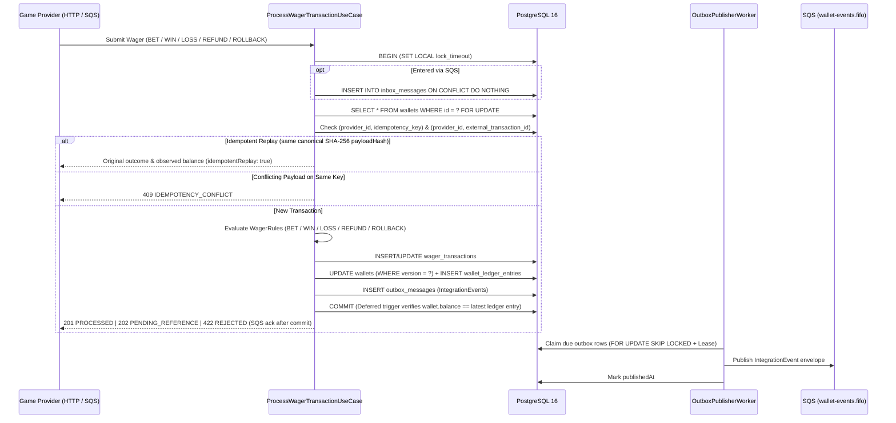

# Distributed Wagering Processor — Technical Challenge

A distributed financial wagering service built with **Bun 1.x**, **TypeScript (strict)**, **NestJS**, **MikroORM**, **PostgreSQL 16**, and **AWS SQS (MiniStack)**.

Designed to remain 100% financially accurate when messages arrive **duplicated**, **out of order**, or **simultaneously across multiple instances**, and when processes crash before or after committing.

| Document | Description |
|---|---|
| [`README.md`](./README.md) | Setup, commands, API reference, test suite, load test & AWS cost estimation |
| [`ARCHITECTURE.md`](./ARCHITECTURE.md) | Architectural decisions, concurrency model, schema invariants, Inbox/Outbox, Auth & trade-offs |
| [`docs/CHALLENGE.md`](./docs/CHALLENGE.md) | Original challenge specification |

---

## 1. Quick Start (100% Isolated in Docker)

You do **not** need Bun, Node.js, PostgreSQL, or LocalStack installed on your host machine. Everything runs isolated inside Docker containers.

### Start the Full Stack (PostgreSQL + MiniStack SQS + Application)

```bash
docker compose up -d --build
```

- **API Base URL:** `http://localhost:3000`
- **Liveness Probe:** `GET http://localhost:3000/health/live`
- **Readiness Probe:** `GET http://localhost:3000/health/ready`
- **Prometheus Metrics:** `GET http://localhost:3000/metrics`

### Run Typecheck, Unit, Integration & Concurrency Tests (with Coverage)

```bash
# Start PostgreSQL and MiniStack
docker compose up -d postgres ministack

# Run strict TypeScript check + full test suite + coverage report inside Docker
docker compose run --rm --no-deps -e DATABASE_HOST=postgres -e SQS_ENDPOINT=http://ministack:4566 app sh -c "bun run typecheck && bun test --coverage"
```

### Run the Multi-Instance Load Test (`test:load`)

```bash
docker compose run --rm --no-deps -e DATABASE_HOST=postgres -e SQS_ENDPOINT=http://ministack:4566 app bun run test:load
```

*(If you also have `bun` installed locally, you can run `bun install`, `bun test`, `bun run test:coverage`, and `bun run test:load` directly against the Dockerized PostgreSQL and MiniStack ports `5432` and `4566`.)*

---

## 2. Architecture & Guarantee Summary



### How Every Non-Negotiable Constraint is Enforced

1. **No `number`/`float` for money:** `Money` wraps `decimal.js` with a fixed scale of 2 decimal places (`"25.00"`) and is persisted in PostgreSQL as `NUMERIC(20,2)`.
2. **Persistent idempotency:** Enforced in PostgreSQL via `UNIQUE (provider_id, idempotency_key)` and `UNIQUE (provider_id, external_transaction_id)`. A canonical `SHA-256` hash (`payloadHash`) of sorted business fields distinguishes replays (`200 OK`) from payload tampering (`409 Conflict`).
3. **Per-wallet concurrency (`walletId`):** Operations acquire a pessimistic row lock (`SELECT ... FOR UPDATE` with bounded `lock_timeout`) on the target wallet + optimistic `version` check + `UNIQUE (wallet_id, wallet_version)` on the ledger. Distinct wallets run completely in parallel.
4. **Append-only immutable ledger:** `WalletLedgerEntry` has no mutators, and PostgreSQL triggers (`ledger_append_only`) block `UPDATE`, `DELETE`, and `TRUNCATE` on `wallet_ledger_entries`.
5. **Database-enforced wallet $\leftrightarrow$ ledger consistency:** A `DEFERRABLE INITIALLY DEFERRED` constraint trigger (`wallet_ledger_consistency`) verifies at the end of every SQL transaction that `(wallets.balance, wallets.version)` matches the latest ledger entry.
6. **Atomic Inbox & Outbox:** SQS consumption records `(consumer_name, message_id)` in `inbox_messages` and only calls SQS `DeleteMessage` (`ack`) **after** the SQL transaction commits. Integration events are written to `outbox_messages` in the same SQL transaction and published by concurrent workers using `FOR UPDATE SKIP LOCKED` + time-bounded leases.

---

## 3. HTTP API Reference

### 3.1 Create Wallet (`POST /wallets`)

```bash
curl -X POST http://localhost:3000/wallets \
  -H "Content-Type: application/json" \
  -d '{
    "playerId": "0192f28f-5dc0-7d58-bdb2-814ad6a0f4a1",
    "initialBalance": { "amount": "1000.00", "currency": "BRL" }
  }'
```

When `initialBalance > 0`, an internal `OPENING` transaction and a `CREDIT` ledger entry are created in the same SQL transaction (`version: 1`). Creating a duplicate wallet for the same `playerId + currency` returns `409 Conflict` (`WALLET_ALREADY_EXISTS`).

### 3.2 Submit Wager Transaction (`POST /wagering/transactions`)

```bash
curl -X POST http://localhost:3000/wagering/transactions \
  -H "Content-Type: application/json" \
  -H "Idempotency-Key: provider-a:transaction-123" \
  -d '{
    "providerId": "provider-a",
    "externalTransactionId": "transaction-123",
    "playerId": "0192f28f-5dc0-7d58-bdb2-814ad6a0f4a1",
    "walletId": "0192f291-27dd-7d3f-8071-5f8685deef37",
    "roundId": "round-987",
    "gameId": "fortune-chimp",
    "kind": "BET",
    "money": { "amount": "25.00", "currency": "BRL" }
  }'
```

| Outcome | HTTP Status | Response Highlights |
|---|---|---|
| Processed (first submission) | `201 Created` | `{ status: "PROCESSED", idempotentReplay: false, balance }` |
| Processed (idempotent replay) | `200 OK` | `{ status: "PROCESSED", idempotentReplay: true, balance }` (original observed balance) |
| Reference not arrived yet | `202 Accepted` | `{ status: "PENDING_REFERENCE", balance }` |
| Business rule rejection | `422 Unprocessable Entity` | `{ status: "REJECTED", failureCode: "INSUFFICIENT_FUNDS" \| ..., balance }` |
| Idempotency key conflict | `409 Conflict` | `{ error: { code: "IDEMPOTENCY_CONFLICT", transactionId } }` |
| Invalid payload / Money | `400 Bad Request` | `{ error: { code: "VALIDATION_ERROR" \| "INVALID_MONEY", details } }` |
| Transient DB / lock timeout | `503 Service Unavailable` | `{ error: { code: "TRANSIENT_FAILURE", retryable: true } }` |

### 3.3 Queries, Reconciliation & Health Checks

- `GET /wallets/:walletId` — Current wallet balance and version.
- `GET /wallets/:walletId/ledger?cursor=...&limit=50` — Keyset-paginated ledger entries using an opaque base64url cursor.
- `GET /wagering/transactions/:transactionId` — Transaction details by internal UUID.
- `GET /providers/:providerId/wagering/transactions/:externalTransactionId` — Transaction details by provider and external ID.
- `POST /wallets/:walletId/reconciliation` — Compares `storedBalance` against `SUM(ledger)` inside a `REPEATABLE READ` snapshot.
- `GET /health/live` & `GET /health/ready` — Liveness and readiness (PostgreSQL + SQS) probes.
- `GET /metrics` — Prometheus metrics (`wager_transactions_total`, `wager_duplicates_total`, `wager_retries_total`, `sqs_dead_lettered_messages_total`, `wallet_lock_conflicts_total`, `outbox_lag_seconds`, `wager_processing_duration_seconds`).

---

## 4. Test Suite & Concurrency Scenarios

All integration and concurrency tests run against **real PostgreSQL 16 and real MiniStack SQS containers** (zero database or queue mocks), verifying `wallet.balance == ledger reconstructed balance` at the end of every test.

| Suite | File | What is Verified |
|---|---|---|
| **Unit** | [`test/unit/domain.spec.ts`](./test/unit/domain.spec.ts) | `Money` scale/validation/immutability, `Wallet` & `WalletLedgerEntry` invariants, `WagerTransaction` state machine, all `WagerRules` (`BET`, `WIN`, `LOSS`, `REFUND`, `ROLLBACK`), `REVERSAL_INSUFFICIENT_FUNDS` vs `INSUFFICIENT_FUNDS`, canonical `payloadHash`, `InboxMessage`, `OutboxMessage`, `IntegrationEvent` envelopes |
| **Integration** | [`test/integration/integration.spec.ts`](./test/integration/integration.spec.ts) | Reversible migrations (`down`/`up`), direct SQL violations against DB constraints/triggers, full HTTP lifecycle, opaque cursor pagination, SQS inbox redelivery, DLQ on poison messages, `PENDING_REFERENCE` expiration (`REFERENCE_NOT_FOUND`), outbox publishing |
| **Concurrency** | [`test/concurrency/concurrency.spec.ts`](./test/concurrency/concurrency.spec.ts) | **1.** Same bet 50× in parallel → 1 debit, 49 replays<br>**2.** 100.00 BRL wallet vs 2×80.00 BRL simultaneous bets → 1 `PROCESSED`, 1 `REJECTED`, final balance 20.00 BRL<br>**3.** 12 distinct wallets mutated in parallel<br>**4.** 3 independent NestJS instances hammering 1 hot wallet (30 concurrent bets)<br>**5.** Worker crash after SQL commit and before SQS `ack` → redelivery deduplicated via inbox<br>**6.** 2 concurrent outbox publishers + expired lease recovery<br>**7.** Out-of-order `ROLLBACK` before `BET` → `PENDING_REFERENCE` → resolved to `PROCESSED`<br>**8.** Full service restart preserving idempotency and ledger consistency |

### Latest Test & Load Benchmark Evidence

- **Test Execution (`bun test --coverage`):** `23 pass, 0 fail` (`432 expect() calls`) — **98.45% line coverage** across all modules (`100%` across Domain, Use Cases, Controllers, and Repositories).
- **Load Test (`bun run test:load` — 3 application instances + PostgreSQL 16 + MiniStack SQS in Docker):**
  - **Distributed Workload (20 wallets, 300 requests, concurrency 30):** `300/300` succeeded (`0%` error rate), `~62.8 req/s`, `p50: 423ms`, `p95: 759ms`, `p99: 791ms`.
  - **Hot Wallet Contention (1 wallet, 100 requests, concurrency 20 across 3 instances):** `100/100` succeeded (`0%` error rate), `~28.5 req/s`, `p50: 388ms`, `p95: 1510ms`, `p99: 2226ms`.
  - **Post-Load Reconciliation:** `21/21` wallets 100% consistent (`wallet.balance == sum(ledger)`).

---

## 5. Production AWS Infrastructure & Monthly Cost Estimation

Below is a realistic monthly cost estimate (`us-east-1`, on-demand pricing) for running this architecture in production on AWS across three traffic tiers:

| AWS Component | Small / Early Stage (~5M tx/month, ~2 RPS avg) | Medium / Growth (~50M tx/month, ~20 RPS avg) | High Scale (~500M tx/month, ~200 RPS avg, 2k+ peak) |
|---|---|---|---|
| **Compute (ECS Fargate — API + Consumers + Workers)** | 3 tasks × (0.5 vCPU, 1 GB RAM)<br>**~$44 / mo** | 6 tasks × (1 vCPU, 2 GB RAM)<br>**~$175 / mo** | 20 tasks × (2 vCPU, 4 GB RAM)<br>**~$1,165 / mo** |
| **Database (Amazon RDS PostgreSQL Multi-AZ)** | `db.t4g.medium` Multi-AZ + 100 GB gp3<br>**~$125 / mo** | `db.r6g.large` Multi-AZ + 500 GB gp3 + 3k IOPS<br>**~$430 / mo** | `db.r6g.2xlarge` Multi-AZ + 1 Replicas + 2 TB io2<br>**~$2,150 / mo** |
| **Messaging (Amazon SQS FIFO — Wagers + Events + DLQ)** | ~15M FIFO API requests ($0.50/M)<br>**~$8 / mo** | ~150M FIFO API requests<br>**~$75 / mo** | ~1.5B FIFO API requests<br>**~$750 / mo** |
| **Load Balancing & Edge (ALB + NAT Gateway)** | 1 ALB + 1 NAT Gateway<br>**~$65 / mo** | 1 ALB + 2 NAT Gateways (HA)<br>**~$130 / mo** | 1 ALB (high LCU) + 3 NAT Gateways + VPC Endpoints<br>**~$310 / mo** |
| **Observability (CloudWatch Logs + AMP Prometheus)** | 20 GB logs + basic metrics<br>**~$18 / mo** | 150 GB logs + Managed Prometheus<br>**~$110 / mo** | 1 TB logs (sampled) + AMP/Grafana<br>**~$620 / mo** |
| **Estimated Total (Monthly)** | **~$260 / month** | **~$920 / month** | **~$4,995 / month** |

### Cost Optimization Recommendations for Production
1. **Gateway VPC Endpoints for SQS:** Configuring an AWS PrivateLink Interface Endpoint for SQS eliminates NAT Gateway data-processing charges ($0.045/GB) for high-volume SQS polling and outbox publishing.
2. **SQS Batching (`SendMessageBatch` / `DeleteMessageBatch`):** Grouping up to 10 outbox events or consumer acks per SQS API call reduces SQS FIFO request costs by up to **90%**.
3. **Table Partitioning & Archival:** Partitioning `wallet_ledger_entries`, `wager_transactions`, `inbox_messages`, and `outbox_messages` by month (or pruning published outbox/inbox rows older than 30 days to S3 Parquet) keeps hot B-tree indexes in RDS buffer cache and avoids vertical RDS scaling.
4. **Graviton + Compute Savings Plans:** Running Bun on ARM64 (`linux/arm64` Fargate Graviton2/3) with 1-year Compute & RDS Reserved Instances cuts compute and database bills by **35–45%**.

